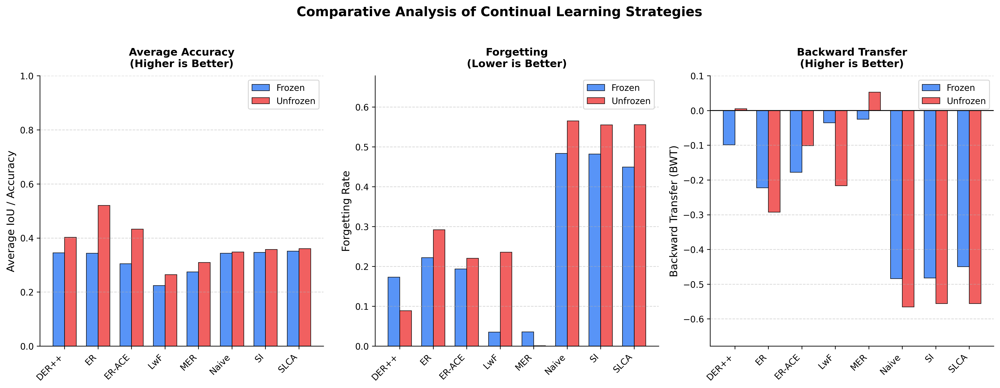

# Shipping Container Defect Segmentation via Continual Learning

A Continual Learning (CL) framework for dense, pixel-level shipping container defect segmentation. It adapts eight CL strategies (rehearsal, regularization, meta-learning and classifier alignment) from image classification to semantic segmentation. All of them are built on a self-supervised Vision Foundation Model (**DINOv3**) and aim to reduce catastrophic forgetting as new defect types are learned one at a time.

> Developed as a Final Year Project (FYP) at Universiti Malaya, 2026.

---

## Results

Five tasks, class-incremental: each task introduces one new defect type, and the model never sees task IDs at inference. The DINOv3 ViT-L/16 backbone is either **frozen** (only the ~2.7M-parameter decoder trains) or **unfrozen** (the last 12 Transformer blocks are fine-tuned as well).



| Strategy | Avg mIoU ↑ (Frozen) | Forgetting ↓ (Frozen) | BWT ↑ (Frozen) | Avg mIoU ↑ (Unfrozen) | Forgetting ↓ (Unfrozen) | BWT ↑ (Unfrozen) |
| :--- | :---: | :---: | :---: | :---: | :---: | :---: |
| Naive Fine-Tuning | 0.344 | 0.484 | -0.484 | 0.348 | 0.565 | -0.565 |
| ER | 0.344 | 0.222 | -0.222 | **0.521** | 0.292 | -0.292 |
| ER-ACE | 0.305 | 0.194 | -0.178 | 0.433 | 0.221 | -0.101 |
| DER++ | 0.346 | 0.173 | -0.099 | 0.402 | 0.089 | +0.005 |
| MER | 0.275 | 0.036 | -0.025 | 0.310 | **0.001** | **+0.053** |
| SI | 0.347 | 0.482 | -0.482 | 0.358 | 0.556 | -0.556 |
| LwF | 0.224 | **0.035** | -0.035 | 0.265 | 0.236 | -0.216 |
| SLCA | **0.352** | 0.450 | -0.450 | 0.361 | 0.556 | -0.556 |
| *Joint training (upper bound)* | *0.467* | — | — | *0.587* | — | — |

**Key takeaways**

* **Rehearsal methods give the best overall trade-off.** With an unfrozen backbone, ER reaches 0.521 average mIoU, close to the joint-training upper bound. DER++ keeps forgetting under 9% and has slightly positive backward transfer.
* **MER is the most stable strategy:** forgetting is near zero and backward transfer is positive. The cost is lower plasticity on new tasks.
* **Regularization-only methods (SI) and SLCA end up close to naive fine-tuning** in this class-incremental segmentation setting, so they offer little protection against forgetting here.
* **Unfreezing the backbone raises average mIoU for every strategy.** Without replay it also increases forgetting.

---

## Key Highlights & Architecture

*   **Vision Foundation Model Backbone:** **DINOv3 (`vitl16`, ~305M parameters)**. It can be used as a fully frozen feature extractor, or the last $N$ Transformer blocks can be unfrozen and fine-tuned.
*   **Progressive Upsampling Decoder:** A convolutional decoder head that progressively upsamples ViT patch tokens ($48 \times 48$) to full target resolution ($768 \times 768$) via:
    $$\text{Conv2d(3x3)} \rightarrow \text{BatchNorm} \rightarrow \text{ReLU} \rightarrow \text{Dropout (p=0.1)} \rightarrow \text{Bilinear Upsampling (2x)}$$
*   **8 Continual Learning Strategies**, re-engineered for spatial `(B, C, H, W)` inputs and dense pixel targets:
    *   *Regularization-based:* **Synaptic Intelligence (SI)**, **Learning Without Forgetting (LwF)**.
    *   *Rehearsal-based:* **Experience Replay (ER)**, **ER with Asymmetric Cross-Entropy (ER-ACE)**, **Dark Experience Replay++ (DER++)**.
    *   *Meta-Learning & Classifier Alignment:* **Meta-Experience Replay (MER)**, **Slow Learner with Classifier Alignment (SLCA)**.
    *   *Baseline:* **Naive Fine-Tuning**, which suffers severe catastrophic forgetting.
*   **Class-Incremental Task Protocol:** 6 classes (background + 5 defect types: paint, patch, removal, sealant and wash repair), split into 5 sequential tasks with one defect type per task. During training, pixels of classes outside the current task are relabelled as background.
*   **CL Metrics:** Average mIoU / pixel accuracy, Forgetting and Backward Transfer (BWT), computed from the full task-accuracy matrix.

---

## Directory Structure

```text
├── FYP2.ipynb                      # Google Colab notebook (interactive training/evaluation)
├── archive/                        # Earlier FYP1 notebooks, kept for reference
├── docs/assets/                    # Figures used in this README
├── pyproject.toml                  # Project metadata & dependencies
├── uv.lock                         # Lockfile managed by uv
├── requirements.txt                # pip-compatible export of uv.lock
└── src/
    └── fyp/
        ├── config.py               # Hyperparameters, dataset selection & project paths
        ├── main.py                 # CLI runner for CL strategies and the joint baseline
        ├── app.py                  # Streamlit dashboard (analytics + live inference)
        ├── cl/
        │   ├── buffer.py           # Reservoir-sampling replay buffer
        │   ├── factory.py          # Strategy registry / factory
        │   ├── metrics.py          # Average accuracy, Forgetting & BWT trackers
        │   ├── trainer.py          # Sequential task training loop
        │   └── strategies/         # naive, er, er_ace, derpp, mer, si, lwf, slca
        ├── data/
        │   ├── dataset.py          # Dataset loader (COCO polygons or binary PNG masks)
        │   └── task_manager.py     # Class-incremental task splitter & label masking
        ├── models/
        │   ├── backbone.py         # DINOv3 feature extractor & selective unfreezing
        │   ├── decoder.py          # Progressive upsampling segmentation head
        │   └── segmenter.py        # Backbone + decoder
        ├── training/
        │   ├── metrics.py          # IoU / pixel-accuracy computation
        │   └── trainer_baseline.py # Joint (non-CL) baseline trainer
        └── utils/
            ├── helpers.py                  # Checkpoint I/O, dataset extraction, run indexing
            ├── visualization.py            # Accuracy matrices, curves & comparison plots
            ├── generate_full_comparison.py # Frozen vs. unfrozen comparison chart
            └── prune_checkpoints.py        # Shrinks frozen-run checkpoints to decoder-only weights
```

---

## Setup & Installation

This project uses [**`uv`**](https://github.com/astral-sh/uv) for package management. Python ≥ 3.10 is required.

### 1. Install `uv`
```bash
curl -LsSf https://astral.sh/uv/install.sh | sh
```

### 2. Install dependencies
From the repository root:
```bash
uv sync
```
This creates a `.venv` and installs everything in `pyproject.toml` (PyTorch, Transformers, Streamlit, etc.). If you prefer pip, use `pip install -r requirements.txt` instead.

### 3. Get access to DINOv3 (Hugging Face)
The `facebook/dinov3-*` checkpoints are **gated** on Hugging Face. Before the first run:
1. Open the model page (e.g. [`facebook/dinov3-vitl16-pretrain-lvd1689m`](https://huggingface.co/facebook/dinov3-vitl16-pretrain-lvd1689m)) and accept the license.
2. Log in locally:
   ```bash
   uv run huggingface-cli login
   ```
The weights download automatically the first time a model is built.

### Hardware requirements
The reported experiments ran on a single **NVIDIA A100** GPU. ViT-L at $768 \times 768$ with batch size 8 needs a large amount of GPU memory, especially when backbone blocks are unfrozen. On smaller GPUs, edit `src/fyp/config.py` and either:
* switch `BACKBONE` to a smaller variant (`vits16`, `vitsp16`, `vitb16`), or
* lower `BATCH_SIZE` or `IMAGE_SIZE` (which must stay divisible by `PATCH_SIZE = 16`).

---

## Dataset

> **The datasets used in this project are proprietary and are not included in this repository.** The code expects your own data in one of the two formats below.

Pick the format with `DATASET_TYPE` in `src/fyp/config.py`:

| `DATASET_TYPE` | Format | Classes | Task split |
| :--- | :--- | :--- | :--- |
| `"NEW"` (default) | COCO segmentation (polygons) | 6 (background + 5 defect types) | Class-incremental: one category per task |
| `"OLD"` | Images + binary `*_mask.png` masks | 2 (background + defect) | Source-incremental: by filename prefix |

**Where to put the data.** Copy your dataset `.zip` into `data/` and set `NEW_ZIP_PATH` (or `OLD_ZIP_PATH`) in `config.py` to its filename. The archive is extracted automatically on the first run. You can also extract it yourself into the expected folder:

```text
data/
└── coco_dataset/                   # NEW_DATASET_ROOT  (OLD format: data/dataset/)
    ├── train/
    │   ├── _annotations.coco.json  # OLD format: no JSON; <image>_mask.png per image
    │   └── *.jpg
    └── valid/
        ├── _annotations.coco.json
        └── *.jpg
```

For the COCO format, category IDs `1–5` map to the five defect classes (paint, patch, removal, sealant, wash). ID `0` is the parent "defect" supercategory, as in a standard Roboflow COCO export. The `data/` directory is git-ignored.

---

## Running Experiments

```bash
# Run one or more CL strategies (default: er_ace)
uv run python -m src.fyp.main --strategies naive er der++

# Run every strategy
uv run python -m src.fyp.main --strategies naive er er_ace der++ mer si lwf slca

# Unfreeze the last 12 DINOv3 blocks (default 0 = fully frozen backbone)
uv run python -m src.fyp.main --strategies der++ --unfreeze_last_n_blocks 12

# Train the joint baseline (all tasks at once, the CL upper bound)
uv run python -m src.fyp.main --joint
```

| Flag | Description |
| :--- | :--- |
| `--strategies` | Space-separated list from: `naive`, `er`, `er_ace`, `der++`, `mer`, `si`, `lwf`, `slca` |
| `--unfreeze_last_n_blocks N` | Number of final backbone blocks to fine-tune (overrides `UNFREEZE_LAST_N_BLOCKS`) |
| `--joint` | Train the joint (non-continual) baseline instead of CL strategies |

All other hyperparameters (epochs, learning rate, buffer size, number of tasks, and the MER / SI / LwF / SLCA settings) live in `src/fyp/config.py`.

**Outputs.** Each invocation creates a new, auto-numbered run:
* `models/run_N/`: model checkpoints (`*.pth`)
* `results/run_N/`: `cl_results_<strategy>.json` (full metrics and accuracy matrix), `cl_matrix_<strategy>.png`, `cl_curves_<strategy>.png` and `cl_comparison.png`

---

## Evaluation & Comparative Visualization

The pipeline reports **Average mIoU / Pixel Accuracy**, **Forgetting** and **Backward Transfer (BWT)** for every strategy.

### Frozen vs. unfrozen comparison chart
To combine several runs into one grouped bar chart (like the one above):
```bash
uv run python src/fyp/utils/generate_full_comparison.py --runs run_2 run_3 run_7 --output-name final_comparison.png
```
Each run is labelled frozen or unfrozen by checking whether its checkpoint contains backbone weights. The chart is saved to `results/`.

### Shrinking checkpoints
Frozen-backbone runs only need decoder weights. This rewrites their checkpoints in place to save disk space:
```bash
uv run python src/fyp/utils/prune_checkpoints.py run_2 run_3
```

---

## Streamlit Interactive Dashboard

```bash
uv run streamlit run src/fyp/app.py --server.port 8501
```
Then open `http://localhost:8501`. The dashboard reads runs from `models/` and `results/` and provides:
* **CL Analytics & Comparisons:** per-strategy accuracy matrices and curves, a strategy leaderboard, and a side-by-side frozen vs. unfrozen backbone comparison.
* **Inference Playpen:** pick a trained checkpoint and run live segmentation on validation images.

---

## Notebook

`FYP2.ipynb` is a Google Colab version of the same pipeline, set up for a T4 GPU and Google Drive storage. It mirrors the code in `src/fyp/`. Earlier FYP1 notebooks are in `archive/` for reference.

---

## Continual Learning Strategy Adaptations

*   **Experience Replay (ER):** Concatenates current images and targets with replayed samples into unified 4D tensors `(B + B_buf, 3, 768, 768)` and computes dense, pixel-wise cross-entropy over the combined batch.
*   **ER-ACE (Asymmetric Cross-Entropy):** Broadcasts asymmetric masks `(1, C, 1, 1)` across the spatial logit channels to exclude future/unseen classes from the loss. This stops new-class gradients from pushing old-class pixels towards background.
*   **Dark Experience Replay++ (DER++):** Adds a pixel-wise MSE distillation loss between the current model's outputs and the dense 4D logit maps stored in the replay buffer. Stored logits are moved to the CPU after each forward pass to save GPU memory.
*   **Synaptic Intelligence (SI):** Tracks per-parameter importance in a Python dictionary (`self.big_omega`) for trainable parameters only. This avoids allocating flat tensors for the large DINOv3 backbone.
*   **Meta-Experience Replay (MER):** Applies Reptile-style inner-loop ($\beta$) and outer-loop ($\gamma$) meta-updates restricted to the trainable (decoder) parameters.
*   **Slow Learner with Classifier Alignment (SLCA):** Resizes the masks to the $48 \times 48$ patch-token grid and collects the token features under each active defect label to build per-class feature statistics. It then re-aligns the decoder on these spatial prototypes after each task.
*   **Learning Without Forgetting (LwF):** Computes pixel-level KL divergence between the current logit maps and those of a frozen pre-task snapshot, scaled by $T^2$. It is the only strategy that needs no replay buffer.

---

## Acknowledgements & References

* **DINOv3:** Siméoni et al., *DINOv3*, Meta AI, 2025.
* **Mammoth** continual learning library ([aimagelab/mammoth](https://github.com/aimagelab/mammoth)), used as a reference for the strategy implementations and hyperparameters.
* **ER:** Chaudhry et al., *On Tiny Episodic Memories in Continual Learning*, 2019.
* **ER-ACE:** Caccia et al., *New Insights on Reducing Abrupt Representation Change in Online Continual Learning*, ICLR 2022.
* **DER++:** Buzzega et al., *Dark Experience for General Continual Learning: a Strong, Simple Baseline*, NeurIPS 2020.
* **MER:** Riemer et al., *Learning to Learn without Forgetting by Maximizing Transfer and Minimizing Interference*, ICLR 2019.
* **SI:** Zenke et al., *Continual Learning Through Synaptic Intelligence*, ICML 2017.
* **LwF:** Li & Hoiem, *Learning without Forgetting*, ECCV 2016 / TPAMI 2017.
* **SLCA:** Zhang et al., *SLCA: Slow Learner with Classifier Alignment for Continual Learning on a Pre-trained Model*, ICCV 2023.

---

## License

Released under the [MIT License](LICENSE).
